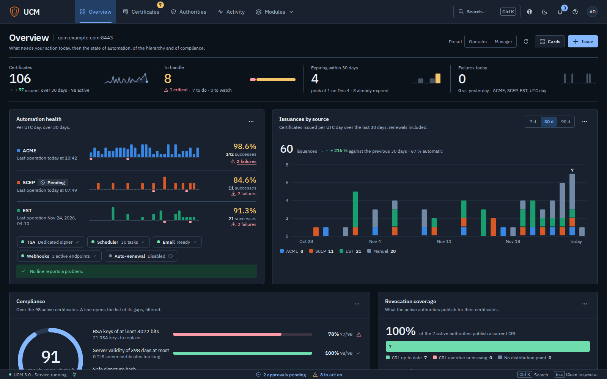

# Ultimate Certificate Manager

[English](README.md) · [Français](README.fr.md) · [Deutsch](README.de.md) · [Español](README.es.md) · [Italiano](README.it.md) · [Português (Brasil)](README.pt.md) · [Русский](README.ru.md) · [Українська](README.uk.md) · [日本語](README.ja.md) · [中文](README.zh.md)


[](https://ko-fi.com/neyslim)

**Ultimate Certificate Manager (UCM)** は、PKI プロトコル (ACME、SCEP、EST、OCSP、CRL/CDP)、Microsoft ADCS 連携、多要素認証、証明書のライフサイクル管理に対応した、Web ベースの認証局 (CA) 管理プラットフォームです。

> **UCM は若く、活発に開発が進められているプロジェクトです。** フィードバック、バグ報告、機能要望を歓迎します。お気軽に [issue を作成](https://github.com/NeySlim/ultimate-ca-manager/issues)してください。報告のひとつひとつが UCM の改善につながります。

> 新機能については、[最新のリリースノート](https://github.com/NeySlim/ultimate-ca-manager/releases/latest)と [CHANGELOG](CHANGELOG.md) 全体をご覧ください。



---

## 機能

### PKI コア
- **CA 管理** -- ルート CA と中間 CA、階層ビュー、インポート/エクスポート、**中間 CA の失効** (親の CRL と OCSP に反映され、その配下は「上位で失効」状態になります)、**証明書のみの CA** (外部の要求で署名された CA で、秘密鍵は後からインポート)、**HSM 保管の署名鍵** (秘密鍵は HSM の外に出ません)、**設定可能な RFC 5280 プロファイル** (署名ダイジェスト、Key Usage、EKU)、**発行フォームからの非表示** (中間 CA への署名専用のルートなど。Let's Encrypt 風の既定値と、任意の **RSA-PSS** 署名方式つき)、ANSSI、BSI、EU の合意メカニズムに沿った**コンプライアンスプロファイル**、**外部署名の CA** (UCM が鍵ペアと CA 型の CSR を生成し、オフライン/外部のルートが署名します。秘密鍵は UCM の外に出ず、同一鍵の CSR による更新にも対応)、**クロス署名 CA 証明書** (CA 自身の証明書と並べて添付またはクロス署名し、ルート切り替え中は既定のチェーンで提供し、エクスポートやデプロイごとにチェーンを選択し、旧ルートにまだチェーンしているものを確認)、作成時に設定する **RFC 5280 の名前制約** (許可および除外する DNS、IP 範囲、E-mail のサブツリー。すべての発行経路で強制)、1 年または最大 50 年までの任意の日数の有効期間、任意の**サブジェクト一意性**ルール (その CA 配下で別のエンティティがすでに使用しているサブジェクトの証明書は、すべての発行経路で拒否されます。RFC 5280 §4.1.2.6)
- **証明書ライフサイクル** -- 発行、署名、失効 (RFC 5280 の理由つき。すべての失効ダイアログと一括操作から)、更新 (**インプレース**: 更新後も ID は不変で、置き換えられたシリアルは元の有効期限まで CRL/OCSP に残り、選択した有効期間もポリシーの上限で制限されます)、名前変更 (変更可能な表示名。CN のない証明書にも対応)、エクスポート (PEM、DER、PKCS#12 (Android 15 以前、macOS 14 以前、古い Windows や Java 向けの 3DES/SHA-1 互換モードあり)、JKS。チェーンには既定で自己署名ルートを含めず、パッケージ化やインポート先で必要な場合は **ルート CA を含める** オプションを使用)、一括操作、ステータス/発行者/ソース (ACME、SCEP、EST、AD CS、インポートなど) によるフィルタ。更新や再登録で**アーカイブ**され履歴として保持されるレコードも対象です。各証明書にプレーンテキストの**コメント**を付けることができ、一覧とグローバル検索で見つかります
- **適合性リンティング** -- pkilint (利用可能な場合は zlint も) による、RFC 5280、CA/Browser Forum Baseline Requirements、ETSI EN 319 412 に対する証明書ごとのチェック。情報提供のみです
- **CSR 管理** -- 証明書署名要求の作成、インポート、署名。**カスタム Extra EKU OID** (RFC 5280 §4.2.1.12)、**型付き SAN の検証** (DNS / IP / Email / URI / UPN)、NIST P-256 / P-384 / P-521 と Brainpool P256r1 / P384r1 / P512r1 曲線、**外部 CA 返却パス** (UCM で生成した CSR に対して別の場所で発行された証明書は、インポート時にその CSR を完了させ、秘密鍵を保持します) に対応。**署名時に追加される名前** (CN だけを持つスマートカードからの S/MIME 要求のメールアドレス。同じ名前制約、ポリシー、承認の下で)と、履歴からの**再署名** (要求を二度生成できないデバイス向け) も可能です
- **証明書テンプレート** -- サーバー、クライアント、コード署名、E-mail、Windows スマートカードログオン向けの定義済みプロファイル。鍵タイプは RSA-2048/3072/4096、EC P-256/P-384/P-521、Brainpool、**ポスト量子 ML-DSA-44/65/87** (CA には Ed25519/Ed448)、**OID 指定のカスタム X.509 拡張**、**qcStatements (ETSI EN 319 412-5) と証明書ポリシー OID**、発行フォームに事前入力されるサブジェクトの既定値 (E-mail を含む)。すべての設定を保持する JSON のエクスポートとインポートは、1 ファイルにつき 1 つまたは複数のテンプレートに対応します
- **証明書ディスカバリ** -- ネットワークスキャン、スキャンプロファイル、スケジュールスキャン、証明書のインポート
- **トラストストア** -- 信頼済みルート CA 証明書を、期限アラートと一括削除つきで管理
- **チェーン修復** -- AKI/SKI に基づくチェーン検証と、自動修復スケジューラ
- **SSH 証明書** -- SSH 認証局の管理、**HSM 鍵**上の SSH CA (RSA または NIST ECDSA。秘密鍵はトークンの外に出ません)、ホスト/ユーザー証明書の署名、CA と証明書のインポート、curl で使えるセットアップスクリプト。鍵 ID は CA が命名 (`principals@CA name`) するか、要求側に任せられます

### プロトコル
- **ACME** -- RFC 8555、自動登録、自動更新、DNS-01/HTTP-01/TLS-ALPN-01 チャレンジ、ワイルドカード対応、**IP 識別子 (RFC 8738)**、**アカウント/メソッドの紐づけによる CAA チェック (RFC 8657/8659)**、**External Account Binding (EAB、RFC 8555 §7.3.4)**、**Renewal Information (ARI、RFC 9773)**、**UCM が配信する HTTP-01 チャレンジファイル** (ポート 80 から `/.well-known/acme-challenge/` を転送し、送信前に確認し、自動で更新)、スプリットホライズン向けの **DNS-01 リゾルバの選択** (自動、システムのみ、または指定したリゾルバのみ。公開リゾルバにアクセスできないネットワーク向け)、内部/プライベート IP 上の ACME (同一ホストの CA 向けに、ループバックのアップストリームをオプトインで許可)、**マルチ CA 管理** (要求ごとの CA 選択。更新時に同じ CA を再利用するよう注文に固定します。Let's Encrypt、Actalis、ZeroSSL、Google Trust Services、HARICA など)、**外部 CSR と更新時の鍵再利用**、**ステージング事前ドライラン**、**マルチ CA プロキシ** (検証済みのアップストリームドメインはそのまま通過し、CA ごとのエンドポイントは `/acme/proxy/<slug>/directory`、アップストリームの失効にも対応)、**優先証明書チェーン** (RFC 8555 §7.4.2 の代替チェーン。CA アカウントごと)、**証明書プロファイル** (draft-ietf-acme-profiles: ディレクトリで公開され、注文ごとに選択できる名前つきの発行ポリシー。それぞれに証明書テンプレートを紐づけることができ、その場合はテンプレートの Key Usage と EKU が発行される証明書を決定します。プロファイルを指定しない注文向けの**既定プロファイル**と既定の署名ダイジェストも用意)、**ローカルサーバー注文の管理** (クリーンアップと、期限切れ注文の定期パージを備えた注文ビュー)。プロキシはクライアント側の dns-01 TXT 値も公開するため、クライアントの伝播事前チェック (lego、Traefik、Caddy) がそのまま通ります。再試行時にはアカウントの保留中の注文を再利用し、任意の **DNS UPDATE (RFC 2136) リスナー**により、cert-manager などの標準的な rfc2136 ソルバーがアカウントごとの TSIG 鍵でプロキシ経由の DNS-01 に応答できます
- **SCEP** -- RFC 8894 のデバイス自動登録 (承認ワークフローつき)、GetCert/GetCRL、署名つき GetNextCACert、sscep などのクライアント向けのプレーン HTTP ポート (RSA-OAEP 鍵トランスポートのみを受け付ける FIPS モードを除く) の任意利用、デバイスの証明書で認証される更新、RSA 以外のクライアント向けにパスワードベース (PBKDF2) へフォールバックする AES-128 暗号化。手動で承認された要求は、自動承認と同様に、経由したプロファイルのテンプレートで発行されます。名前つきプロファイルはテナントの Intune API に対して **Microsoft Intune** チャレンジを検証し、Windows (RSAES-OAEP 鍵トランスポート) と Apple のデバイスがそれらを通じて登録します。[docs/integrations/intune-scep.md](docs/integrations/intune-scep.md) を参照してください
- **EST** -- RFC 7030 Enrollment over Secure Transport。サーバー側の鍵生成 (CMS §4.4) と **CA ラベル** (§3.2.2: 1 つのエンドポイントで複数の CA を提供) を含みます
- **OCSP** -- RFC 6960 のリアルタイム証明書ステータス、複数証明書の要求、nonce 対応、レスポンダ証明書の自動更新つき委任レスポンダの検証、設定可能なレスポンス有効期間
- **TSA (RFC 3161)** -- ポリシー OID を設定できるタイムスタンプ局。**専用のエンドエンティティ署名証明書** (RFC 3161。既定で必須で、`openssl ts -verify` や jarsigner などの厳格な検証ツールでも必須) で署名します。発行済み証明書から選ぶか、ワンクリックで生成でき (critical かつ排他的な timeStamping EKU)、更新は自動で追従し、発行者チェーンはトークンに埋め込まれ、厳格な専用署名者モードを備え、署名者の健全性と有効期限は概要に表示されます
- **CRL/CDP** -- Delta CRL (RFC 5280 §5.2.4) 対応の証明書失効リスト配布、CA ごとのスケジュール (有効期間と公開間隔を分離)、設定可能な署名ダイジェスト、任意の名前つき URL (CDP/AIA パスの CA 名スラッグ。既存の CA でも有効化可能)、**オフライン/鍵なし CA 向けの外部署名 CRL アップロード** (CA 証明書に対して CRL 番号の単調増加も含めて検証され、既存の CDP エンドポイントで提供され、OCSP からも参照されます)
- **AIA CA Issuers** -- Authority Information Access による CA 証明書のダウンロード (RFC 5280 §4.2.2.1)

### 連携
- **Microsoft ADCS** -- AD CS 上の完全なライフサイクル: CSR 署名、テンプレート検出、EOBO (Enroll On Behalf Of)、コネクタ経由の更新/失効。任意の WinRM 管理チャネルにより、CRL 失効の同期、CA インベントリのインポート、保留中の要求の承認/拒否、CA ヘルスパネルを利用できます
- **Windows 自動登録と Active Directory コネクタ** -- ドメイン参加のマシンとユーザー向けの MS-XCEP/WSTEP のポリシーと登録。要求が指定するテンプレートに従います。Kerberos バインドでは、マシンおよび AD 由来のテンプレートはサブジェクトを Active Directory から取得し (コンピューターの DNS ホスト名、またはユーザーの DN と UPN)、複数のドメインコントローラーにまたがってフェイルオーバーし、DC ごとの定期ヘルスチェックを行い、匿名バインドは決して使用しません。登録は**レルムごとのプロファイル** (`/api/v2/windows-profiles`) で設定され、それぞれが独自の CA、テンプレート、Kerberos keytab、AD グループ、コネクタを持ちます。Kerberos の要求は、そのプリンシパルのレルムの有効なプロファイルで処理されます (UsernamePassword バインドは、有効であれば既定のプロファイルで、証明書バインドの更新は提示された証明書に記録されたプロファイルで処理されます)。**複数の Active Directory コネクタ** (フォレストまたはドメインごとに 1 つ) にも対応します
- **Microsoft Intune** -- Intune 管理デバイス向けの SCEP チャレンジ検証。Entra アプリ登録は SCEP › Intune アプリ登録で一度定義し、プロファイルごとに選択します。手順は `docs/integrations/intune-scep.md` にあります
- **HSM** -- SoftHSM 同梱、PKCS#11、Azure Key Vault、Google Cloud KMS、OpenBao/Vault Transit。エクスポート不可の署名鍵を持つ **HSM 保管の CA**、PKCS#11 上の RSA-PSS と Brainpool、EU コンプライアンスプロファイルが検査する、宣言されたデバイス認証 (Common Criteria、EUCC、FIPS 140-3)。接続テストでは、PKCS#11 モジュールが報告する内容 (ライブラリ、製造元、ファームウェア) を確認できます
- **Kubernetes / cert-manager** -- `examples/kubernetes/cert-manager/` 配下の、ClusterIssuer (EAB つきの HTTP-01 + DNS-01)、Certificate のサンプル、Secret テンプレートの参照マニフェスト
- **DNS プロバイダー** -- ACME DNS-01 チャレンジ向けの Cloudflare、Route53、Azure DNS、Plesk など
- **Webhook** -- 証明書ライフサイクルイベント (15 種類以上) のイベント駆動通知、**エンドポイントごとの配信履歴と手動再試行**、指数バックオフつきの永続的な非同期配信キュー、履歴が際限なく増えないようにする保持期間

### セキュリティとアクセス
- **認証** -- パスワード、WebAuthn/FIDO2 (TOTP と併用または代替の第 2 要素としても)、TOTP 2FA、mTLS、API キー (`X-API-Key` または `Authorization: Bearer`)
- **セッションロック** -- アカウントメニューまたは Alt+Shift+L でセッションをロックします。すべてのタブがロックされ、サーバーは、そのアカウント自身がパスワード、クライアント証明書、パスキーでロックを解除するまでロック状態を保ちます
- **SSO** -- LDAP (LDAPS または StartTLS)、OAuth2 (Azure/Google/GitHub)、シングルログアウトつきの SAML シングルサインオン、組み込みロールおよび**カスタムロール**へのロールマッピング (アサーションから読み取る SAML グループ。Entra ID と AD FS のクレームを含む) と設定可能な NameID 形式。**ユーザーごとの `auth_source` 追跡**と、ログイン時のロール同期 (オプトイン)。**Microsoft Entra マルチテナント**サインイン (許可するテナントの一覧つき)、有効化の前にプロバイダーが与えるアイデンティティ、グループ、ロールを表示する**テストサインイン**、**複数のプロバイダー**で開けるアカウントにも対応します
- **RBAC** -- 4 つの組み込みロール (Admin、Operator、Auditor、Viewer) と、きめ細かな権限を持つカスタムロール。**グループはユーザーのロールに加えて追加の権限を付与**します (管理者権限は付与されません)
- **ポリシーと承認** -- 承認ワークフローと強制ルール (許可する鍵タイプと署名ハッシュ、DNS SAN の上限、有効期間の上限。CA、テンプレート、DNS パターンで範囲指定) を備えた証明書発行ポリシー。**すべてのオペレーター経路** (発行フォーム、保存済み要求への単独または一括の署名、更新) に適用され、鍵タイプとハッシュについては ACME、SCEP、EST、WSTEP、CA 作成にも適用されます。承認を必須とするポリシーは **ACME、EST、SCEP、WSTEP の要求**を承認キューに保留し、各クライアントにはそのプロトコルの用語で通知されます (ACME `processing`、Retry-After つきの EST 202、SCEP PENDING、WSTEP pending)。ポリシーは**失効と更新**を承認の対象にすることもできます。キューにある要求は、その間に対象が署名、更新、削除、失効された場合、自動的にクローズされます
- **鍵とハッシュの既定値** -- 鍵やハッシュを指定しない要求は、すべての発行経路で 1 つの既定に従います (プロファイルやポリシーが拒否しない限り SHA-256 の RSA-2048、拒否される場合は最初に許可されたタイプ)。ハッシュは署名鍵に従い、新しい中間 CA が親より弱いハッシュを使うことはありません
- **監査ログ** -- 整合性検証、リモート syslog 転送、オプトインの保持期間を備えた操作ログ
- **秘密鍵の暗号化** -- 初回起動時に作成される (コンテナでは `/etc/ucm` がボリュームの場合)、または `KEY_ENCRYPTION_KEY` で指定するマスターキーによる、保存時の AES-128 (Fernet、HMAC-SHA256) 暗号化。CA と証明書の鍵、SSH CA とデプロイ先の鍵、ACME アカウントと EAB の鍵、SCEP チャレンジ、LDAP バインドパスワードを対象とし、有効化前に保存されたシークレットには **残りの鍵を暗号化** を使用できます。暗号化が有効な間は平文の鍵ファイルがディスクに残らず (既存のミラーは有効化時と起動時に削除されます。公開証明書ファイルは残ります)、無効化すると鍵ファイルが再作成されます
- **高可用性** -- `UCM_HA=1` により、1 つの PostgreSQL データベース上で 2 台以上のノードを実行します (Docker、Docker Compose、DEB/RPM、または Helm チャートの `ha.enabled`)。選出された 1 台のノードがスケジュールタスクを実行し、設定と暗号化の変更はすべてのノードに反映され、バックアップとリストアはどのノードからでも行え、パッケージの更新は 1 ノードずつ順に適用され、セッションは共有されるため、送信元アドレスのアフィニティが必要なのは Kerberos 登録エンドポイントだけです ([docs/HA.md](docs/HA.md) を参照)
- **FIPS モード** -- `-fips` Docker イメージは、UCM の暗号処理を OpenSSL FIPS Provider 3.5.9 (CMVP 証明書 #5586) 上で実行します。これは ML-DSA、Ed25519、Ed448 を承認しているため、このイメージでは FIPS モードでもポスト量子署名と EdDSA 署名を利用できます。`UCM_FIPS_BUILD=1` でビルドした DEB と RPM パッケージは、RHEL 9 (#5573) または Ubuntu 24.04 Pro (#5115) の FIPS モジュール上で動作しますが、これらはそれらを提供しません。`UCM_FIPS=1` を指定すると、UCM は有効で自己テスト済みのモジュール上でのみ起動し、鍵をそのモジュールで生成し、ロード済みのモジュールが承認したアルゴリズムだけを許可し、それ以外 (MD5、3DES、scrypt、Argon2id、レガシー PKCS#12、NTLM) を拒否します。レディネスチェックにより、インスタンスが事前に何を失うかを一覧できます。UCM 自体は検証済みモジュールではなく、Debian 13 と arm64 は証明書 #5586 のテスト済み構成に含まれません
- **コンプライアンスプロファイル** -- ANSSI PG-083、BSI TR-02102-1、ECCG の合意された暗号メカニズムに沿った CA ごとのポリシー (鍵タイプ、ハッシュ、署名方式、有効期間の上限、HSM 保管の CA 鍵、EC タイムスタンプ署名者)。文書が義務づける箇所は拒否、推奨する箇所は通知とし、既存の CA にプロファイルを適用する前の読み取り専用のプリフライトを備えます。UCM はこれらのいずれの機関からも認証や認定を受けていません
- **SBOM** -- リリースごとのすべてのパッケージとイメージのプラットフォーム向けの CycloneDX SBOM。ファイルハッシュまたはイメージダイジェストに紐づけられ、同梱物をバージョンと宣言されたライセンスとともに一覧し、パッケージがインストール時に解決するものも示します ([docs/SBOM.md](docs/SBOM.md))
- **ハードニング** -- オペレーターが設定できる HSTS (設定 → セキュリティ または環境変数による上書き)、クライアント証明書ヘッダーの信頼プロキシによる制限、作成者自身の権限を上限とする API キー権限。信頼プロキシは CIDR ネットワークで指定でき、プロキシ対応を有効にすると `X-Forwarded-*` ヘッダーはそれらからのものだけが受け入れられるため、バックエンドに直接到達するクライアントがアドレスを偽装することはできません。Web インターフェースと管理 API は、**指定した IP アドレスとネットワークに制限**でき、PKI プロトコルのエンドポイントには引き続き到達できます

### 運用と監視
- **概要** -- 4 つの主要指標、初回セットアップの手順、9 つの独立したカード (更新、再試行、公開の操作を備えた作業キュー、自動化の健全性、ソース別の発行、有効期限の見通し、コンプライアンス、失効カバレッジ、階層、最新の操作、認証局と HSM)。表示、非表示、並べ替えができ、レイアウトプリセットはユーザーごとに保存され、データが変わると自動で再読み込みされます
- **レポート** -- スケジュール PDF レポート、エグゼクティブサマリー、失効済み証明書、カスタムテンプレート
- **証明書ツールボックス** -- SSL チェッカー、CSR/証明書デコーダー、鍵マッチャー、フォーマット変換
- **E-mail 通知** -- STARTTLS または暗黙の TLS (ポート 465) 対応の SMTP、Gmail、Outlook.com、Microsoft 365 向けの **OAuth2 (XOAUTH2)**、カスタマイズ可能な HTML/テキストテンプレート、複数の日数しきい値による証明書の期限アラート (しきい値と有効期間ごとに 1 通。30/14/7/1 のように段階的)、ACME クライアントが自分で更新する証明書を対象外にすることも可能
- **デプロイフック** -- 発行および更新された証明書と、再生成された CRL (DER、または親 CRL を含む PEM バンドル) を、SSH/SFTP でリモートホストへ配信します。宛先パスと任意のリロードコマンドはバインディングごとに指定でき、鍵ベース認証 (生成した ed25519 鍵またはインポートした鍵。保存時に暗号化)、初回接続時のホストキー固定、バインディングごとの宛先パス (証明書/鍵/フルチェーン。バインディングが要求しない限り自己署名ルートを含まないチェーン。アトミックに書き込み)、再試行と配信ごとの履歴を備えた永続的な配信キュー、UCM の隣で動くサービス向けの**同一ホストプリセット**、ボディテンプレート (URL、メソッド、暗号化されたヘッダー、`{{cert_pem|json}}` 形式の変数。秘密鍵は検証済み HTTPS 上での明示的なオプトインがある場合のみ) から組み立てた 1 回のリクエストで、ファイアウォール、ロードバランサー、クラウド API に証明書を送る **HTTP API ターゲット**に対応します
- **バックアップとリストア** -- 保持ポリシーと、保存済みアーカイブが使う容量の任意の上限を備えた、手動およびスケジュールの暗号化バックアップ。アーカイブは個別に認証されるチャンクのストリームなので、作成時やリストア前の検査でアーカイブ全体をメモリに載せることはありません。アーカイブには ACME クライアントの注文と保留中の要求が含まれ、マージまたは置換モードでリストアし、インストール間では名前で行を照合し、修復マイグレーションを再実行します
- **診断ログバンドル** -- アプリケーションログ、エラーログ、systemd ジャーナル、シークレットを含まないシステム診断を ZIP としてワンクリックでダウンロード (設定 → バージョン情報 → 診断)。機密トークンは伏せ字になります
- **システムログビューア** -- アプリケーション、アクセス、エラー、systemd ジャーナルのログを UI から閲覧でき、レベル、時間範囲、テキストで絞り込めます。シークレットは伏せ字になります
- **Prometheus メトリクス** -- オプトインで、ベアラートークンで保護された `/metrics` エンドポイントが、証明書、CA、スケジューラ、Webhook、ACME のカウンターを公開します
- **スケジューラ** -- バックグラウンドタスク (期限チェック、CRL 更新、Webhook 配信、バックアップ、自動更新) の管理ビュー。ステータス表示と今すぐ実行に対応し、gunicorn の下で独自のプロセスとして動作します
- **自己提供の HTTPS** -- 発行済みの任意の証明書を Web UI に適用できます。バインディングは更新に自動で追従します (ファイルを再生成し、サービスを再起動)
- **安全なネットワークの既定値** -- デュアルスタックでの待ち受け (`HOST=::` は 1 つのソケットで IPv6 と IPv4 を提供)、管理者向けの Base URL ガードレール (適用前の到達性チェック、ホストが名前解決できなくなると正規リダイレクトが解除される仕組み、`UCM_DISABLE_CANONICAL_REDIRECT=1` による復旧スイッチ)
- **ソフトウェアアップデート** -- ワンクリックでインストールできるアプリ内アップデートチェッカー、安定版またはリリース候補チャネルの毎日のスケジュールチェック、SHA256 検証が必須で結果を正確に伝えるイベント (実際のインストールがバージョン確認された後にのみ「インストール済み」) を伴う、オプトインの無人インストール (DEB/RPM)。さらに、更新後にユーザーごとに 1 回だけ表示できるリリースノートウィンドウもあります
- **グローバル検索** -- リソース横断の検索とコマンドパレット (Ctrl+K)

### プラットフォーム
- **テーマ** -- Atelier と Aurore。それぞれダークまたはライトで、システム設定に従うことも可能。**ユーザーごとの設定をサーバー側で保持** (言語、テーマ、モード)
- **i18n** -- 10 言語 (EN、FR、DE、ES、IT、PT、UK、RU、ZH、JA)
- **UI 状態の保持** -- 主な一覧ページ (証明書、CA、テンプレート、ポリシー、監査ログ、トラストストア、ユーザー、SSH) で、フィルタの選択が再読み込み後も保持されます
- **データベース** -- SQLite (既定) または、双方向マイグレーション UI を備えた**ネイティブ PostgreSQL バックエンド**
- **レスポンシブ UI** -- React 18 + Radix UI、モバイル対応
- **インスペクターと分離ウィンドウ** -- 各オブジェクトは、オブジェクトごとのタブを持つドッキング式のインスペクターで開くか、独立したウィンドウに分離してページをまたいで残せます。**比較**では 2 件から 4 件の証明書を並べて表示し、異なる行を強調します
- **リアルタイム** -- WebSocket によるライブ更新: 別のオペレーターによる変更はそれを表示する一覧に反映され、障害後の再接続では古い行を画面に残さず再読み込みされます
- **マルチプラットフォーム** -- Docker、Debian/Ubuntu (.deb)、RHEL/Rocky/Fedora (.rpm)、Helm チャートによる Kubernetes (`oci://ghcr.io/neyslim/charts/ucm`)。パッケージはアクセスログとエラーログのログローテーションをインストールします
- **リバースプロキシ対応** -- リッスンポートから独立した公開ポート (ベース URL で明示した `:80` や `:443` は入力どおりに通知されます)、IP または CIDR ネットワークによる信頼プロキシ、UCM の前段に置く Ingress 向けの Helm チャート `proxy.*` 値

---

## クイックスタート

### Docker

```bash
docker run -d --restart=unless-stopped \
  --name ucm \
  -p 8443:8443 \
  -p 8080:8080 \
  -v ucm-data:/opt/ucm/data \
  -v ucm-config:/etc/ucm \
  neyslim/ultimate-ca-manager:latest
```

GitHub Container Registry からも入手できます: `ghcr.io/neyslim/ultimate-ca-manager`。FIPS 版には `<version>-fips` タグが付きます (`UCM_FIPS=1` で実行してください)。3.x のリリースだけを追うには `3` (または `3-fips`) を固定してください。

### Debian/Ubuntu

[最新リリース](https://github.com/NeySlim/ultimate-ca-manager/releases/latest)から `.deb` パッケージをダウンロードします。

```bash
sudo dpkg -i ucm_<version>_all.deb
sudo systemctl enable --now ucm
```

### RHEL/Rocky/Fedora

[最新リリース](https://github.com/NeySlim/ultimate-ca-manager/releases/latest)から `.rpm` パッケージをダウンロードします。Fedora 向けは `ucm-VERSION-1.fc43.noarch.rpm`、RHEL、Rocky Linux、AlmaLinux 9 向けは `ucm-el9-VERSION-1.el9.noarch.rpm`、同じディストリビューションの 10 向けは `ucm-el10-VERSION-1.el10.noarch.rpm` です。

```bash
sudo dnf install ./ucm-VERSION-1.fc43.noarch.rpm
sudo systemctl enable --now ucm
```

**アクセス:** `https://localhost:8443` または `https://your-server-fqdn:8443`
**初回ログイン:** `admin`。パスワードは初回起動時に生成されます: `sudo cat /opt/ucm/data/initial-admin-password` (Docker: `docker exec <container> cat /opt/ucm/data/initial-admin-password`)。初回ログイン時に変更が必要です。独自のパスワードを指定するには、[First access](docs/installation/README.md#first-access) を参照してください。

Docker Compose やソースからのインストールを含むすべての方法については、[インストールガイド](docs/installation/README.md)を参照してください。

---

## ドキュメント

| リソース | リンク |
|----------|------|
| Wiki (完全なドキュメント) | [github.com/NeySlim/ultimate-ca-manager/wiki](https://github.com/NeySlim/ultimate-ca-manager/wiki) |
| インストール | [docs/installation/](docs/installation/README.md) |
| ユーザーガイド | [docs/USER_GUIDE.md](docs/USER_GUIDE.md) |
| 管理者ガイド | [docs/ADMIN_GUIDE.md](docs/ADMIN_GUIDE.md) |
| Microsoft Intune SCEP | [docs/integrations/intune-scep.md](docs/integrations/intune-scep.md) |
| ACME プロキシクライアント | [docs/integrations/acme-proxy-clients.md](docs/integrations/acme-proxy-clients.md) |
| API リファレンス | [docs/API_REFERENCE.md](docs/API_REFERENCE.md) |
| セキュリティ | [docs/SECURITY.md](docs/SECURITY.md) |
| アップグレードガイド | [UPGRADE.md](UPGRADE.md) |
| 変更履歴 | [CHANGELOG.md](CHANGELOG.md) |

---

## 技術スタック

| コンポーネント | 技術 |
|-----------|------------|
| フロントエンド | React 18、Vite、Radix UI |
| バックエンド | Python 3.11+、Flask、SQLAlchemy |
| データベース | SQLite または PostgreSQL |
| サーバー | Gunicorn + gevent WebSocket |
| 暗号 | pyOpenSSL、cryptography |
| 認証 | セッション Cookie、WebAuthn/FIDO2、TOTP、mTLS |

---

## ファイルの場所

| 項目 | パス |
|------|------|
| アプリケーション | `/opt/ucm/` |
| データと DB | `/opt/ucm/data/` |
| 設定 (DEB/RPM) | `/etc/ucm/ucm.env` |
| ログ (DEB/RPM) | `/var/log/ucm/` |
| サービス | `systemctl status ucm` |

Docker: データは `/opt/ucm/data/` (ボリュームとしてマウント)、設定は環境変数、ログは標準出力に出力されます。

---

## コントリビュート

プルリクエストは `dev` を対象とし、最初の 1 件では [CLA](CLA.md) への署名を一度だけお願いしています。バグを有用に報告する方法、レビューしやすいプルリクエストの形、テスト、翻訳、マイグレーションに関するルールなど、その他の詳細は [CONTRIBUTING.md](CONTRIBUTING.md) を参照してください。

---

## ライセンス

UCM は [GNU AGPL v3.0 only](LICENSE) の下で提供されるフリーソフトウェアです。規模を問わず、商用でも、無償で利用できます。改変しても変更を公開できない場合には、[商用ライセンス](COMMERCIAL-LICENSE.md)が用意されています。

2.243 より前のバージョンは、Commons Clause 付きの BSD 3-Clause という元のライセンスのままです。

---

## サポート

- [GitHub Issues](https://github.com/NeySlim/ultimate-ca-manager/issues)
- [GitHub Wiki](https://github.com/NeySlim/ultimate-ca-manager/wiki)

UCM が役に立つと感じたら、開発の支援をご検討ください。

<a href="https://ko-fi.com/neyslim"></a>
