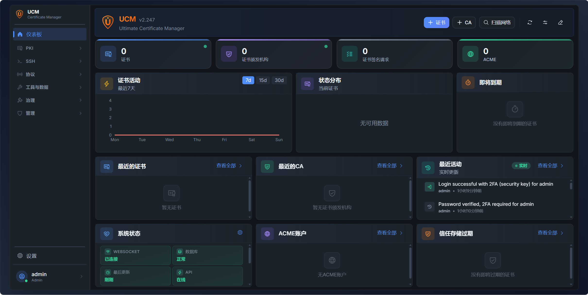

[English](README.md) | [简体中文](README_zh.md)

**翻译说明**：
本文档基于英文原版 `v2.247` 版本（2026年11月）翻译，目前正在翻译。
由于项目功能迭代较快，部分最新细节可能未及时同步。如需查看最新特性，请参考 [英文原版 README](README.md)。
# Ultimate Certificate Manager


[](https://ko-fi.com/neyslim)

**Ultimate Certificate Manager (UCM)** 是一个基于 Web 的证书颁发机构管理平台，支持 PKI 协议（ACME、SCEP、EST、OCSP、CRL/CDP），集成 Microsoft ADCS，提供多因素认证和证书生命周期管理。

> **UCM 是一个年轻且开发活跃的项目，** 我们非常欢迎反馈、bug报告和功能请求！ 欢迎随时 [提交issue](https://github.com/NeySlim/ultimate-ca-manager/issues)： 每一份报告都有助于让 UCM 变得更好。

> 更新内容请参阅 [最新版本说明](https://github.com/NeySlim/ultimate-ca-manager/releases/latest) 和完整的 [更新日志](CHANGELOG.md)。



---

## 功能特性

### PKI 核心
- **CA 管理** -- 根 CA 和中间 CA、层级视图、导入/导出， **中间 CA 吊销** （吊销状态通过父 CA 的 CRL 和 OCSP 响应发布， 下级证书因上级 CA 被吊销而失效）， **仅证书 CA** (根据外部请求签发、私钥稍后导入的 CA), **HSM-backed signing keys** （私钥永不离开 HSM）， **可配置的 RFC 5280 证书配置文件** （签名摘要算法， Key Usage, EKU）， 默认采用 Let's Encrypt 风格配置，并可选支持 **RSA-PSS** 签名方案， 与 ANSSI、BSI 及欧盟商定机制对齐的**合规配置文件**， **外部签发的 CA** （UCM 生成密钥对和 CA 类型的 CSR，由离线/外部根 CA 签名；私钥永不离开 UCM，并支持同密钥 CSR 续期）， **交叉签名的 CA 证书** （可在 CA 自身证书旁附加或交叉签名一个证书，在根证书轮换期间将其作为默认证书链提供，按导出或部署选择证书链，并查看哪些证书仍能链到旧根）， **RFC 5280 名称约束** 在创建时设置 （允许和排除的 DNS、IP 范围与电子邮件子树，并在每条签发路径上强制执行）， 有效期可设为 1 年或任意天数，最长 50 年。
- **证书生命周期** -- 签发、签名、吊销 （支持 RFC 5280 吊销原因，可在每个吊销对话框和批量操作中指定）， 续期 (**in-place**: 多次续期不改变 ID；被取代的序列号在其原始到期日前仍保留在 CRL/OCSP 中；所选有效期仍受策略上限约束）， 重命名 （可修改显示名称，包含无 CN 证书）， 导出 （支持 PEM, DER, PKCS#12 格式，支持 3DES/SHA-1 兼容模式，以兼容 Android 15 及更早版本、macOS 14 及更早版本、旧版 Windows 和 Java、JKS；默认情况下，证书链不包含自签名根证书，如果打包或导入目标需要包含根证书，可启用**包含 CA**选项）， 批量操作， 按状态 / 颁发者 / 来源 (ACME, SCEP, EST, AD CS, 导入...）筛选， 包含在续期或重新注册过程中被归档、并作为历史记录予以保留的记录。
- **符合性检查** -- 通过 pkilint（以及在可用时的 zlint）对每张证书依据 RFC 5280、CA/Browser Forum 基线要求和 ETSI EN 319 412 进行检查，结果仅供参考。
- **CSR 管理** -- 创建、导入、签发证书签名请求，支持 **自定义额外的 EKU OID** （RFC 5280 §4.2.1.12）， **分类型 SAN 验证** （DNS / IP / Email / URI / UPN），支持 NIST P-256 / P-384 / P-521 和 Brainpool P256r1 / P384r1 / P512r1 曲线，并提供 **外部 CA 回传路径**:对于在 UCM 中生成 CSR，由外部 CA 签发的证书可在导入该证书后即可完成对应 CSR 的签发流程，同时保留原有私钥； **在签发时添加名称** （对于来自智能卡的 S/MIME 证书申请，如果智能卡生成的请求中仅包含 CN， 为其添加电子邮件地址，且遵循相同的名称约束、策略和审批流程），并支持从历史记录中再次签发，以适用于那些无法重复生成请求的设备。
- **证书模板** -- 提供适用于服务器、客户端、代码签名、电子邮件和 Windows 智能卡登录的预定义模板；支持 RSA-2048/3072/4096, EC P-256/P-384/P-521 and Brainpool 密钥类型，支持 **qcStatements (ETSI EN 319 412-5) 和证书策略 OID**， 以及预先填充主题默认值（包括电子邮件地址）；支持通过 JSON 格式导出和导入模板，完整保留所有配置项，每个文件可包含一个或多个模板。
- **证书发现** -- 网络扫描、扫描配置、定时扫描、证书导入。
- **信任库** -- 管理受信任的根 CA 证书，支持到期提醒与批量移除。
- **证书链修复** -- 基于 AKI/SKI 的证书链验证，并支持自动调度修复。
- **SSH 证书** -- SSH 证书颁发机构管理、签发主机/用户证书、导入 CA 及证书，以及兼容 curl 调用的配置脚本。

### 协议
- **ACME** -- RFC 8555， 自动注册、自动续期，支持 DNS-01/HTTP-01/TLS-ALPN-01 挑战、通配符证书， **IP 标识符 （RFC 8738）**, **带账户/方法绑定的 CAA 检查 （RFC 8657/8659）**， **外部账户绑定 （EAB, RFC 8555 §7.3.4）**， **续期信息 （ARI, RFC 9773）**， **由 UCM 提供 HTTP-01 挑战文件** （从80端口转发 `/.well-known/acme-challenge/`，提交前检查，自动续期）， **DNS-01 解析器选择** （自动，仅系统解析器， 或仅使用列出的解析器，适用于无法访问公共解析器的网络）以支持分裂视野，在内部/私有 IP 上使用 ACME （包括为同机部署的 CA 可选启用回环上游）， **多 CA 管理** (按请求选择 CA ，并固定到订单上，使续期复用同一 CA： Let's Encrypt, Actalis, ZeroSSL, Google Trust Services, HARICA…）， **外部 CSR 与续期密钥重用**， **预发布环境预检试运行**， **多 CA 代理** （经过预验证的上游域直接透传， 每个 CA 的端点位于 `/acme/proxy/<slug>/directory`，包括上游吊销）， **首选证书链** （RFC 8555 §7.4.2 的 alternates, 按 CA 账户配置）， **证书配置文件** (draft-ietf-acme-profiles: 在目录中通告的命名签发策略，可按订单选择，每个配置文件可选绑定到一个证书模板，随后由该模板的密钥用法和 EKU 约束所签发的证书，另有**默认配置文件**，以及为未指定配置文件的订单提供默认签名摘要）， **本地服务器订单管理** （订单视图，支持清理，并定时清除过期订单）；代理还发布客户端侧 dns-01 TXT 值，使客户端传播预检查（lego, Traefik, Caddy）可按原样通过，并在重试时复用账户中仍处于待处理状态的订单，可选的 **DNS UPDATE (RFC 2136) 监听器** 使标准 rfc2136 求解器（例如 cert-manager 的求解器）能够通过代理、使用按账户的 TSIG 密钥来应答 DNS-01。
- **SCEP** -- RFC 8894 设备自动注册，带审批工作流，支持 GetCert/GetCRL，签名的 GetNextCACert， AES-128 加密并为非 RSA 客户端提供基于密码（PBKDF2）的回退；手动批准的请求使用其来源配置文件的模板签发，与自动批准完全一致；命名配置文件会针对租户的 Intune API 验证 **Microsoft Intune** 挑战，Windows （RSAES-OAEP 密钥传输）和 Apple 设备通过它们注册，参见 [docs/integrations/intune-scep.md](docs/integrations/intune-scep.md)。
- **EST** -- RFC 7030 安全传输注册，包括服务器端密钥生成 (CMS §4.4) 和 **CA 标签** （§3.2.2: 从一个端点服务多个 CA）。
- **OCSP** -- RFC 6960 实时证书状态，支持多证书请求， nonce 支持，委托响应器验证并自动续期响应器证书，可配置响应有效期。
- **TSA (RFC 3161)** -- 时间戳机构，可配置策略 OID；使用 CA 证书或 **专用终端实体签名证书** 签名，该证书可从已签发证书中选择或一键生成（为满足严格验证器，设置关键且排他的 EKU）；要求 timeStamping EKU，自动跟随续期，令牌中嵌入签发者链，严格专用签名者模式，签名者健康状况和到期信息显示在仪表板上。
- **CRL/CDP** -- 证书吊销列表分发，支持增量 CRL (RFC 5280 §5.2.4), 按 CA 的调度（有效期与发布节奏解耦）和可配置签名摘要，可选命名 URL （在 CDP/AIA 路径中使用 CA 名称 slug，可在现有 CA 上启用）， **为离线/无密钥 CA 上传外部签名 CRL** （根据 CA 证书验证，并要求 CRL 编号单调递增，在现有 CDP 端点提供，并由 OCSP 查询）。
- **AIA CA 签发者** -- 机构信息访问 CA 证书下载（RFC 5280 §4.2.2.1）。

### 集成
- **Microsoft ADCS** -- Full lifecycle over AD CS: CSR signing, template discovery, EOBO (Enroll On Behalf Of), renew/revoke through the connector, and an optional WinRM admin channel for CRL revocation sync, CA inventory import, and pending-request approve/deny with a CA health panel
- **Windows autoenrollment & Active Directory Connector** -- MS-XCEP/WSTEP policy and enrollment for domain-joined machines and users; a subject-less request from GPO autoenrollment is completed from Active Directory (the computer's DNS host name, or the user's DN and UPN), across several domain controllers with failover and a scheduled health check per DC, never with an anonymous bind
- **Microsoft Intune** -- SCEP challenge validation for Intune-managed devices, Entra app registrations defined once under SCEP › Intune app registrations and picked per profile, with a step-by-step guide in `docs/integrations/intune-scep.md`
- **HSM** -- SoftHSM included, PKCS#11, Azure Key Vault, Google Cloud KMS, OpenBao/Vault Transit; **HSM-backed CAs** with non-exportable signing keys, RSA-PSS and Brainpool on PKCS#11, and a declared device certification (Common Criteria, EUCC, FIPS 140-3) checked by the EU compliance profile; a connection test shows what a PKCS#11 module reports (library, manufacturer, firmware)
- **Kubernetes / cert-manager** -- Reference manifests for ClusterIssuer (HTTP-01 + DNS-01 with EAB), sample Certificate, Secret template under `examples/kubernetes/cert-manager/`
- **DNS Providers** -- Cloudflare, Route53, Azure DNS, Plesk and more for ACME DNS-01 challenges
- **Webhooks** -- Event-driven notifications for certificate lifecycle events (15+ event types), **per-endpoint delivery history with manual retry**, durable async delivery queue with exponential backoff, and a retention window on the history so it does not grow without end

### Security & Access
- **Authentication** -- Password, WebAuthn/FIDO2 (also as the second factor, next to or instead of TOTP), TOTP 2FA, mTLS, API keys (`X-API-Key` or `Authorization: Bearer`)
- **SSO** -- LDAP, OAuth2 (Azure/Google/GitHub), SAML single sign-on with role mapping to built-in and **custom roles** (SAML groups read from the assertion, Entra ID and AD FS claims included) and a configurable NameID format; **per-user `auth_source` tracking** and opt-in role sync on login
- **RBAC** -- 4 built-in roles (Admin, Operator, Auditor, Viewer) plus custom roles with granular permissions; **groups grant additional permissions** on top of a user's role (never administrator)
- **Policies & Approvals** -- Certificate issuance policies with approval workflows and enforced rules (allowed key types and signature hashes, DNS SAN cap, validity cap, scoped by CA, template or DNS pattern), binding **every operator path** (the issue form, signing a stored request alone or in bulk, and renewal) and, for key types and hashes, ACME, SCEP, EST, WSTEP and CA creation too; a policy can also put **revocations and renewals** under approval; a queued request is closed on its own when its target is signed, renewed, deleted or revoked meanwhile
- **Audit Logs** -- Action logging with integrity verification, remote syslog forwarding and an opt-in retention period
- **Private Key Encryption** -- AES-256 at rest under a master key file or `KEY_ENCRYPTION_KEY`, covering CA and certificate keys, SSH CA and deployment target keys, ACME account and EAB keys, SCEP challenges and LDAP bind passwords, with **Encrypt remaining keys** for secrets stored before it was enabled; with encryption enabled no plaintext key file is kept on disk (existing mirrors are removed at enable time and at startup, public certificate files stay), and key files are recreated when it is disabled
- **FIPS mode (preview)** -- `-fips` Docker image carrying the OpenSSL FIPS Provider 3.1.2 (CMVP certificate #4985); with `UCM_FIPS=1` UCM starts only on the active, self-tested provider, generates keys through it and refuses what it does not approve (Ed25519, MD5, 3DES, scrypt, Argon2id, legacy PKCS#12, NTLM), and a readiness check lists beforehand what an instance would lose. On RHEL 9 and Ubuntu 24.04 Pro, the DEB and RPM packages built with `UCM_FIPS_BUILD=1` run on the host's FIPS module instead. UCM itself is not FIPS validated
- **Compliance profiles** -- per-CA policies aligned with ANSSI PG-083, BSI TR-02102-1 and the ECCG agreed cryptographic mechanisms (key types, hashes, signature schemes, validity horizons, HSM-held CA keys, EC timestamp signer), refusals where the text imposes and notices where it recommends, with a read-only preflight before a profile is attached to an existing CA; UCM is not certified or qualified by any of these bodies
- **Hardening** -- Operator-configurable HSTS (Settings → Security or env override), trusted-proxy gating of client-cert headers, API key permissions capped to the creator's own; trusted proxies can be given as CIDR networks and, once proxy support is on, `X-Forwarded-*` headers are honoured only from them, so a client reaching the backend directly cannot spoof its address; the web interface and management API can be **restricted to listed IP addresses and networks** while PKI protocol endpoints stay reachable

### Operations & Monitoring
- **Dashboard** -- Customizable drag-and-drop widgets, real-time stats, certificate trends
- **Reports** -- Scheduled PDF reports, executive summaries, revoked certificates, custom templates
- **Certificate Toolbox** -- SSL checker, CSR/cert decoder, key matcher, format converter
- **Email Notifications** -- SMTP with STARTTLS or implicit TLS (port 465), **OAuth2 (XOAUTH2)** for Gmail, Outlook.com & Microsoft 365, customizable HTML/text templates, certificate expiry alerts with several day thresholds (one e-mail per threshold and validity period, escalating 30/14/7/1 style), optionally leaving out the certificates ACME clients renew themselves
- **Deploy Hooks** -- Push issued and renewed certificates, and regenerated CRLs (DER or a PEM bundle with the parent CRLs), to remote hosts over SSH/SFTP, with destination paths and an optional reload command per binding: key-based auth (generated ed25519 or imported key, encrypted at rest), host-key pinning on first connect, per-binding destination paths (cert / key / full chain, the chain without the self-signed root unless the binding asks for it, written atomically), durable delivery queue with retries and per-delivery history and a **same-host preset** for services running next to UCM
- **Backup & Restore** -- Manual and scheduled encrypted backups with retention policies
- **Diagnostic Log Bundle** -- One-click download (Settings → About → Diagnostic) of application logs, error log, systemd journal and a secret-free system diagnostic as a ZIP, with sensitive tokens redacted
- **System Log Viewer** -- Browse the application, access, error and systemd journal logs from the UI, filtered by level, time window and text, with secrets redacted
- **Prometheus Metrics** -- opt-in, bearer-gated `/metrics` endpoint exposing certificate, CA, scheduler, webhook and ACME counters
- **Scheduler** -- admin view of background tasks (expiry checks, CRL refresh, webhook delivery, backups, auto-renewal) with status and run-now
- **Self-serving HTTPS** -- apply any issued certificate to the web UI; the binding follows renewals automatically (files re-materialized, service restarted)
- **Safe networking defaults** -- dual-stack listening (`HOST=::` serves IPv6 and IPv4 on one socket), and admin Base URL guardrails (reachability check before applying, canonical redirect steps aside when the host stops resolving, `UCM_DISABLE_CANONICAL_REDIRECT=1` recovery switch)
- **Software Updates** -- In-app update checker with one-click install, scheduled daily check on a stable or release-candidate channel, and opt-in unattended install (DEB/RPM) with mandatory SHA256 verification and truthful outcome events (installed only after the actual install is version-verified), plus an optional one-time per-user release-notes window after an update
- **Global Search** -- Cross-resource search and command palette (Ctrl+K)

### Platform
- **6 Themes** -- 3 color schemes (Gray, Purple Night, Orange Sunset) × Light/Dark; **per-user preferences persisted server-side** (language, theme, mode)
- **i18n** -- 9 languages (EN, FR, DE, ES, IT, PT, UK, ZH, JA)
- **Persisted UI state** -- Filter selections persist across reloads on every list page
- **Database** -- SQLite (default) or **native PostgreSQL backend** with bidirectional migration UI
- **Responsive UI** -- React 18 + Radix UI, mobile-friendly
- **Real-time** -- WebSocket live updates: a change made by another operator refreshes the lists that show it, and a reconnection after an outage reloads them rather than leaving stale rows on screen
- **Multi-platform** -- Docker, Debian/Ubuntu (.deb), RHEL/Rocky/Fedora (.rpm); the packages install log rotation for the access and error logs
- **Reverse proxy ready** -- Public ports independent of the listen ports (an explicit `:80` or `:443` in the base URLs is advertised as typed), trusted proxies by IP or CIDR network, and Helm chart `proxy.*` values for an Ingress in front of UCM

---

## Quick Start

### Docker

```bash
docker run -d --restart=unless-stopped \
  --name ucm \
  -p 8443:8443 \
  -p 8080:8080 \
  -v ucm-data:/opt/ucm/data \
  neyslim/ultimate-ca-manager:latest
```

Also available from GitHub Container Registry: `ghcr.io/neyslim/ultimate-ca-manager`. The FIPS variant is tagged `<version>-fips` (run it with `UCM_FIPS=1`).

### Debian/Ubuntu

Download the `.deb` package from the [latest release](https://github.com/NeySlim/ultimate-ca-manager/releases/latest):

```bash
sudo dpkg -i ucm_<version>_all.deb
sudo systemctl enable --now ucm
```

### RHEL/Rocky/Fedora

Download the `.rpm` package from the [latest release](https://github.com/NeySlim/ultimate-ca-manager/releases/latest): `ucm-VERSION-1.fc43.noarch.rpm` for Fedora, `ucm-el9-VERSION-1.el9.noarch.rpm` for RHEL, Rocky Linux and AlmaLinux 9.

```bash
sudo dnf install ./ucm-VERSION-1.fc43.noarch.rpm
sudo systemctl enable --now ucm
```

**Access:** `https://localhost:8443` or `https://your-server-fqdn:8443`
**Default credentials:** `admin` / `changeme123`: the first login must set a new password, and until then the server refuses every other request of that session, API included.

See [Installation Guide](docs/installation/README.md) for all methods including Docker Compose and source install.

---

## Documentation

| Resource | Link |
|----------|------|
| Wiki (full docs) | [github.com/NeySlim/ultimate-ca-manager/wiki](https://github.com/NeySlim/ultimate-ca-manager/wiki) |
| Installation | [docs/installation/](docs/installation/README.md) |
| User Guide | [docs/USER_GUIDE.md](docs/USER_GUIDE.md) |
| Admin Guide | [docs/ADMIN_GUIDE.md](docs/ADMIN_GUIDE.md) |
| Microsoft Intune SCEP | [docs/integrations/intune-scep.md](docs/integrations/intune-scep.md) |
| ACME proxy clients | [docs/integrations/acme-proxy-clients.md](docs/integrations/acme-proxy-clients.md) |
| API Reference | [docs/API_REFERENCE.md](docs/API_REFERENCE.md) |
| API Explorer | `/api/docs` on a running server (live, versioned with the build) |
| Security | [docs/SECURITY.md](docs/SECURITY.md) |
| Upgrade Guide | [UPGRADE.md](UPGRADE.md) |
| Changelog | [CHANGELOG.md](CHANGELOG.md) |

---

## Technology Stack

| Component | Technology |
|-----------|------------|
| Frontend | React 18, Vite, Radix UI, Recharts |
| Backend | Python 3.11+, Flask, SQLAlchemy |
| Database | SQLite |
| Server | Gunicorn + gevent WebSocket |
| Crypto | pyOpenSSL, cryptography |
| Auth | Session cookies, WebAuthn/FIDO2, TOTP, mTLS |

---

## File Locations

| Item | Path |
|------|------|
| Application | `/opt/ucm/` |
| Data & DB | `/opt/ucm/data/` |
| Config (DEB/RPM) | `/etc/ucm/ucm.env` |
| Logs (DEB/RPM) | `/var/log/ucm/` |
| Service | `systemctl status ucm` |

Docker: data at `/opt/ucm/data/` (mount as volume), config via environment variables, logs to stdout.

---

## Roadmap

- [ ] **High Availability / Clustering**: Active-passive or active-active HA deployment
- [ ] **Post-Quantum Cryptography**: ML-DSA, ML-KEM, SLH-DSA key types (NIST FIPS 203/204/205)
- [ ] **CMP Protocol (RFC 4210)**: Certificate Management Protocol support
- [ ] **Central management console**: a separate console that registers, monitors and administers several UCM instances (Docker or DEB/RPM), their database settings included, while each instance keeps its own keys and data
- [x] **Cross-signed CA certificates**: cross-certificates are kept beside a CA's own certificate instead of overwriting it, attached on import or signed from UCM; the served one goes into the default chain of exports, deployments, ACME (other chains as RFC 8555 alternates), EST and AIA, a chain can be pinned per export or deployment, and a CA lists what still chains to it so an old root can be retired *(v2.247)*
- [x] **ACME proxy for clients without DNS API access**: an optional DNS UPDATE (RFC 2136) listener with per-account TSIG keys lets standard rfc2136 solvers answer DNS-01 through the proxy, with a guide for certbot, acme.sh, lego, cert-manager, win-acme and Posh-ACME; authorization deactivation (RFC 8555 §7.5.2) is accepted and a known account key gets its account back before any EAB check
- [x] **European compliance profiles**: per-CA profiles aligned with ANSSI, BSI and the ECCG agreed mechanisms with a preflight, RSA-PSS signatures per CA, RSA-3072 by default for new CAs, Brainpool curves end to end, qcStatements in templates and a declared HSM certification for EU qualified use; SM2, GOST and FRP256v1 certificates can be imported and read
- [x] **FIPS mode (preview)**: a `-fips` Docker image on the OpenSSL FIPS Provider 3.1.2, a fail-closed start with `UCM_FIPS=1`, keys generated by the module, refusal of non-approved algorithms on every path, PBKDF2 backups and a readiness check for the switch, DEB and RPM packages built against the FIPS module of RHEL 9 and Ubuntu 24.04 Pro; SAML and WS-Security no longer accept SHA-1 *(v2.241)*
- [x] **Allowed hashes, FIPS-ready password hashing, key types kept everywhere**: policies restrict signature hashes as well as key types, on every issuance protocol; passwords and enrollment secrets are hashed with PBKDF2, so UCM starts on a FIPS-mode host; the Docker image moves to Debian 13; DNS-01 waits for every authoritative nameserver; and no path silently falls back to RSA-2048 any more (CA creation, ACME client orders, renewals, templates over XCEP), while an HSM key sync no longer drops keys *(v2.240)*
- [x] **HTTP-01 served by UCM and DNS-01 resolver choice**: UCM serves the HTTP-01 file of its pending Let's Encrypt orders, so a reverse proxy rule for `/.well-known/acme-challenge/` is enough, checks it before submitting and renews HTTP-01 orders automatically; DNS-01 checks can be limited to the system resolver or to listed resolvers *(v2.239)*
- [x] **Smart-card requests, bulk trust store cleanup, quieter alerts**: names can be added when signing a request (the email address an S/MIME certificate needs when the device sets only a CN) and a signed request signed again, the trust store removes a filtered selection at once, expiry e-mails can leave out ACME certificates, auto-renewal says which expiring certificates it left alone and why, and audit log retention is stored and purges only once an administrator sets it *(v2.238)*
- [x] **Short-lived certificates end to end**: an ACME default profile reaches clients that request none, a renewal can choose its validity, auto-renewal waits for the last third of a certificate's lifetime instead of re-signing a 27-day certificate on every pass, Settings › HTTPS offers certificates in their last 30 days, and a CA can last any number of days; SMTP servers on port 465 (implicit TLS) are reachable, and the Docker image follows `UCM_HTTPS_PORT` *(v2.236)*
- [x] **Every secret under the master key, straight to what was just created, faithful template round-trips**: enabling, disabling and backing up private key encryption covers every secret the master key protects, and keys stored before it was enabled are encrypted from Settings › Security; whatever is created from the interface opens straight away and the certificate list sorts by creation date; a template exported and imported keeps its subject, key usage, EKU and autoenrollment settings, and can carry a subject email; and a PostgreSQL installation keeps starting when pip brings SQLAlchemy 2.1 *(v2.234)*
- [x] **CRL deployment, shared Intune app registrations, multi-DC Active Directory, HSM EC signatures that verify**: CRLs are pushed over SSH/SFTP whenever they change, Intune app registrations are defined once and picked per SCEP profile, the Active Directory Connector fails over between domain controllers it probes on a schedule, a CSR, certificate or CRL signed by an EC key in a PKCS#11 or Azure Key Vault HSM carries a DER signature, and certificates are named by their Common Name with their description alongside *(v2.233)*
- [x] **Intune SCEP enrollment on every platform, root-free deployment chains**: Windows devices enroll through Intune (the client's RSAES-OAEP key transport is accepted and the reply wrapped alike), iPhones no longer receive the CA certificate ahead of their own in the reply, a reused transactionID with another key is refused, a switched-off SCEP endpoint refuses every operation with 503; deployment full chains omit the self-signed root for new bindings, with an Include Root CA option; the Create CA wizard no longer pre-ticks serverAuth on intermediate CAs; and a step-by-step Intune guide ships in `docs/integrations/` *(v2.232)*
- [x] **Leaner packages and a quiet start**: the container image ships the built interface alone instead of the whole frontend tree and its build-time dependencies, close to 340 MB the server never reads; a package or an image built from a working copy no longer carries what that copy holds outside version control, the database, the sessions and the private keys among them; and the service no longer logs two errors at every start over a control socket it never uses *(v2.229)*
- [x] **Issuance paths audited, approvals on every operator action**: an adversarial review of every path that signs a certificate tightened them all, the issuing CA's own validity window is checked before signing, the extensions copied from a request are limited to an allow-list so a requester can no longer smuggle a distribution point or a logon identity into its certificate, key usage is derived from the key algorithm, EST and SCEP re-enrolment require a certificate the CA still holds, enrolling a certificate for mTLS login is limited to one's own records, and auto-renewal covers the certificates whose private key the server actually holds; an issuance policy that requires approval now binds signing a stored request (alone or in bulk) and renewal, and a queued request is closed on its own when a direct action makes it moot, with a seven-day deadline that no longer leaves it counted as pending; a SCEP request approved by hand issues with its profile's template, and the records superseded by a renewal or a re-enrolment are visible as archived *(v2.228)*
- [x] **Delegated OCSP responders that sign, certificate-only CAs, HSM signatures that verify**: a delegated OCSP responder now actually signs (every issuance path emits `id-pkix-ocsp-nocheck`, one rule for assignment, list and runtime), a CA created by signing an external CA request is flagged **certificate only** and can take its private key later, signatures made with HSM keys other than RSA-2048 and P-256 name the digest the provider used, imports re-target the right record among homonyms and refuse a foreign key, backups keep revocations and the offline state, and a CA under a revoked ancestor is shown as revoked upstream *(v2.227)*
- [x] **Intermediate CA revocation**: an intermediate CA is revoked from its parent with the RFC 5280 reason codes, its serial is published on the parent's CRL and answered `revoked` by the parent's OCSP responder, the revoked CA and the CAs below it can no longer sign, and the OCSP responder now answers `good` for a valid sub-CA certificate instead of `unknown` *(v2.226)*
- [x] **External CA return path for CSRs**: a certificate issued by a public or third-party CA for a CSR generated in UCM completes that CSR on import (Certificates page and Smart Import), matched on the key pair so the record keeps its private key and exports with it, the private key of a pending CSR can be downloaded under the `read:private_keys` permission, and a certificate issued from a generated CSR is named by its CN instead of "CSR for" *(v2.225)*
- [x] **Reverse proxy fit and smartcard logon templates**: trusted proxies accept CIDR networks and gate every `X-Forwarded-*` header, the advertised admin and protocol ports can differ from the listen ports, the Helm chart wires the proxy settings and follows the release it ships with, the template editor builds Windows smartcard logon templates with a built-in one, and a reused ACME authorization records the challenge that was actually performed *(v2.224)*
- [x] **ACME profile templates and key-algorithm-aware key usage**: an ACME certificate profile can bind a certificate template whose key usage and EKU govern the issued certificate, and every issuance path (issue form, approvals, ACME, EST, SCEP, WSTEP) now derives key usage from the key algorithm, so ECDSA and Ed25519 leaves no longer assert `keyEncipherment` *(v2.221)*
- [x] **Security hardening, multi-endpoint SCEP, and access-control refinements**: an audit-driven hardening pass tightens issuance (per-path key-strength floor, CSR EKU capping, gated sub-CA minting), ACME (SAN types and subject bound to validated identifiers, SSRF guard on IP orders and cloud-metadata targets), and authorization (mTLS, API-key scoping, TSA, CSRF, SSH, OCSP, and direct private-key export gated behind an admin-only scope so Key Recovery's approval trail can't be bypassed); named SCEP profiles serve multiple enrollment endpoints, each with its own CA, template, challenge and approval policy; delegated OCSP responder certificates renew automatically; EAB credentials can be restricted to specific domains; and user groups can grant permissions from the UI *(v2.204)*
- [x] **Compatibility restore & configurable strictness**: the 2.200 hardening no longer breaks existing deployments: TSA, SCEP, EST, CAA and name-constraints checks default to pre-2.200-compatible behaviour with renewals graced at par, and every strictness switch (CAA enforcement, SCEP signingTime/clock skew, CT SCT embedding/require, OCSP response validity, syslog framing, OIDC ID-token verification incl. issuer/JWKS) is now configurable from the UI; certificate templates now govern the issued KU/EKU, with a `custom` type, an OCSP Signing system template and `OCSPSigning` selectable in the editor *(v2.203)*
- [x] **ACME certificate profiles, EST CA labels and RFC 7807 API errors**: clients can pick a named issuance profile advertised in the ACME directory; EST serves multiple CAs under path labels; API errors are now standard `application/problem+json` problem details while keeping the legacy keys for existing integrations *(v2.201)*
- [x] **Protocol conformance sweep**: RFC-coverage audit and fixes across ACME client/server (state machine, subproblems, TLS-ALPN-01/IP identifiers, upstream revocation, ARI `replaces`), SCEP (GetCert/GetCRL, AES + PBKDF2 encryption), EST (server-side key generation §4.4), OCSP (multi-request, delegated responder validation), CAA (RFC 8657 account/method binding), TSA, CT pre-certificate flow with embedded SCTs, and OIDC id_token verification *(v2.200)*
- [x] **ACME preferred certificate chain**: per-CA-account `preferred_chain` selects an RFC 8555 `Link: rel="alternate"` chain at download time (subject or issuer CN match, e.g. `ISRG Root X1`), in both the ACME client and proxy *(v2.193)*
- [x] **Microsoft AD CS full lifecycle**: Renew/revoke AD CS-issued certificates through the connector, plus an optional WinRM admin channel: revocation propagated to the CA, one-way CRL revocation sync, CA inventory import with reconciliation, and a control panel to approve/deny pending requests with CA health; [guide](https://github.com/NeySlim/ultimate-ca-manager/wiki/Microsoft-CA-Integration) *(v2.192)*
- [x] **Key Archival & Recovery**: Dual-control recovery of archived private keys: request → admin approve (four-eyes) → PKCS#12 download, fully audited; [guide](https://github.com/NeySlim/ultimate-ca-manager/wiki/Key-Recovery) *(v2.171)*
- [x] **Custom external ACME CA for issuance**: a configured custom ACME directory URL plus EAB (Settings → ACME client) is now used by issuance and renewal instead of always hitting Let's Encrypt; account row carries the directory/EAB atomically *(v2.180)*
- [x] **Multi-CA management with per-request selection**: issue from several external ACME CAs (Let's Encrypt, Actalis, ZeroSSL, Google Trust Services, HARICA…); each request picks its CA, the order is pinned to that account so renewals stay on the same authority; CRUD UI for CA accounts with per-account EAB and default selection *(v2.181)*
- [x] **Multi-CA ACME proxy endpoints**: each external CA account can expose its own proxy path at `/acme/proxy/<slug>/directory` alongside the legacy default endpoint, with per-account upstream credentials *(v2.185)*
- [x] **ACME external CSR, renewal key reuse & staging preflight**: finalize with an externally generated CSR (key never enters UCM), keep the same private key across renewals (DANE/TLSA), and dry-run requests against Let's Encrypt staging before touching production rate limits *(v2.184)*
- [x] **Code Signing**: Issue and manage code-signing certificates for Authenticode, JAR and macOS via the `codeSigning` EKU plus platform key purposes (kernel-mode, lifetime, Apple Developer ID); [usage guide](https://github.com/NeySlim/ultimate-ca-manager/wiki/Code-Signing) *(v2.171)*
- [x] **Helm chart**: Package UCM itself as a Helm chart for in-cluster deployment under `charts/ucm/` (single-instance, persistent `master.key`, SQLite or external PostgreSQL) *(v2.171)*
- [x] **SAN database columns derived from final SAN list**: `san_email` / `san_dns` / `san_ip` / `san_uri` always match the X.509 extension, with backfill migration *(v2.140)*
- [x] **On-disk certificate & CA files**: `.crt` / `.key` materialized to disk on every creation path *(v2.140)*
- [x] **ACME External Account Binding (EAB, RFC 8555 §7.3.4)**: Issue/rotate/revoke `kid`+`hmac` pairs for cert-manager / certbot / acme.sh *(v2.139)*
- [x] **ACME custom DNS resolvers + private-IP validation**: Split-horizon DNS, RFC1918/`.lan`/`.local` HTTP-01 & TLS-ALPN-01 *(v2.139)*
- [x] **Kubernetes / cert-manager integration**: Reference manifests for ClusterIssuer (HTTP-01 + DNS-01 with EAB) *(v2.139)*
- [x] **SMTP OAuth2 (XOAUTH2)**: Gmail, Outlook.com, Microsoft 365 modern auth *(v2.134)*
- [x] **SSO `auth_source` tracking + role preservation**: Per-user origin, optional sync-on-login, UI never overwritten *(v2.133)*
- [x] **HSM-backed Certificate Authorities**: Signing key generated/stored in HSM, never exportable *(v2.130)*
- [x] **Native PostgreSQL backend**: Bidirectional migration UI with safety checks *(v2.127)*
- [x] **PostgreSQL feature parity**: Database stats, optimize, integrity check, certificate activity chart all work natively on PostgreSQL *(v2.135)*
- [x] **Custom Extra EKU OIDs**: Microsoft RDP, smartcard logon, document signing, IPsec, Kerberos PKINIT… (RFC 5280 §4.2.1.12) *(v2.128)*
- [x] **Persisted UI filters**: Filter selections survive reloads on every list page *(v2.128)*
- [x] **User preferences server-side**: Language/theme follow the user across browsers *(v2.128)*
- [x] **Windows SSH CA setup script (`.ps1`)**: One-command trust setup for Windows OpenSSH Server *(v2.128/v2.134)*
- [x] **SSH Certificates**: SSH CA management, host/user certificate signing, import, setup scripts *(v2.112)*
- [x] **Security Audit**: Comprehensive security hardening: session fixation, export passwords, LDAP injection, LIKE escaping *(v2.112)*
- [x] **Certificate Transparency (RFC 6962)**: CT log submission, SCT parsing, auto-submit on issuance *(v2.109)*
- [x] **OCSP Delegated Responder (RFC 5019)**: Per-CA delegated responder assignment with EKU validation *(v2.109)*
- [x] **Certificate Practice Statement (CPS)**: Per-CA CPS URI and Policy OID in CertificatePolicies extension *(v2.109)*
- [x] **Multiple CDP/OCSP/AIA URLs**: Multiple distribution points and access descriptions per CA *(v2.109)*
- [x] **RFC 3161 Timestamp Authority (TSA)**: Time stamping server with configurable policy, hash algorithms, and accuracy *(v2.109)*
- [x] **In-App Help Translations**: 208 help files across 8 languages for all 26 sections *(v2.109)*
- [x] **ACME Auto-Supersede**: Automatically revoke old certificates on ACME renewal *(v2.110)*
- [x] **Universal Format Detection**: DER/PEM detection by content across all file uploads *(v2.110)*
- [x] **PKCS7/PKCS12 Decode**: Certificate decoder supports P7B bundles and PKCS12 files *(v2.111)*
- [x] **Delta CRL**: Incremental CRL updates for large deployments *(v2.75)*

## Contributing

Pull requests target `dev`, and the first one asks you to sign the
[CLA](CLA.md) once. See [CONTRIBUTING.md](CONTRIBUTING.md) for the rest: how to
report a bug usefully, what a reviewable pull request looks like, and the rules on
tests, translations and migrations.

---

## License

UCM is free software under the [GNU AGPL v3.0 only](LICENSE). Running it, at any scale and commercially, costs nothing; a [commercial licence](COMMERCIAL-LICENSE.md) is available for those who modify it and cannot publish their changes.

Versions before 2.243 remain under their original licence, BSD 3-Clause with the Commons Clause.

---

## Support

- [GitHub Issues](https://github.com/NeySlim/ultimate-ca-manager/issues)
- [GitHub Wiki](https://github.com/NeySlim/ultimate-ca-manager/wiki)

If you find UCM useful, consider supporting its development:

<a href="https://ko-fi.com/neyslim"></a>
